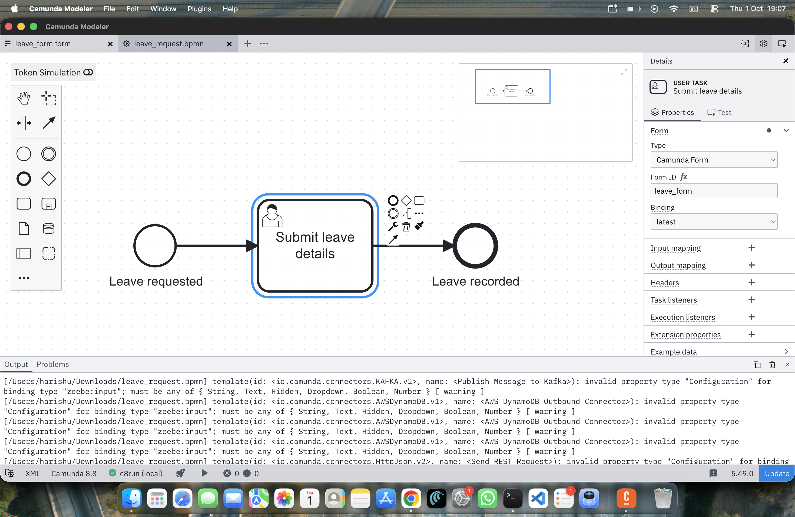
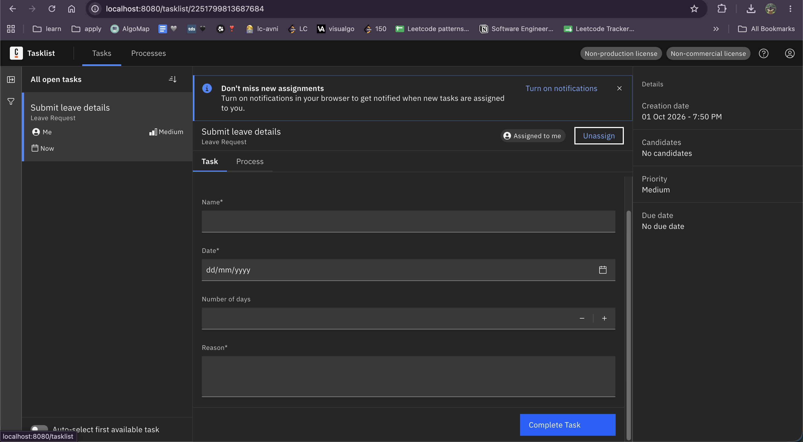
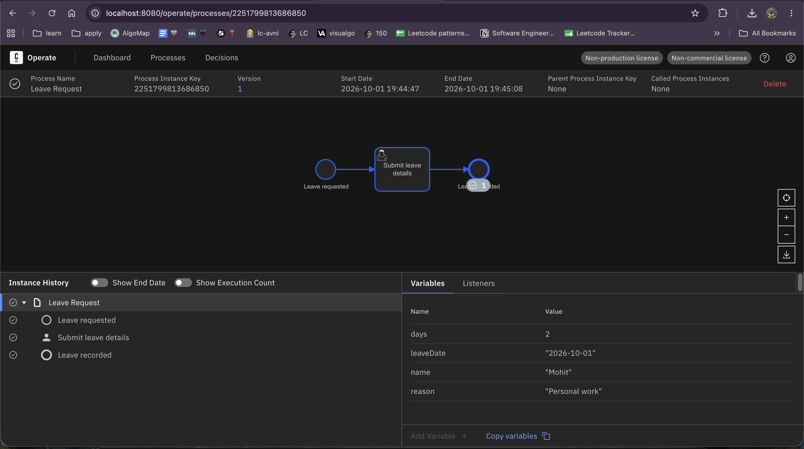

# Camunda Leave Request Process

A simple leave request workflow implemented using Camunda 8.

## Process Flow

Leave requested
      ↓
Submit leave details
      ↓
Leave recorded

## Form Fields

- Name
- Date
- Number of days
- Reason

## Execution

The process was deployed and executed successfully using
Camunda 8 Run.

The leave details were submitted through Tasklist and the
process completed successfully. The completed instance was
verified in Operate.

## Screenshots

### BPMN Process

### Tasklist Form

### Completed Process
